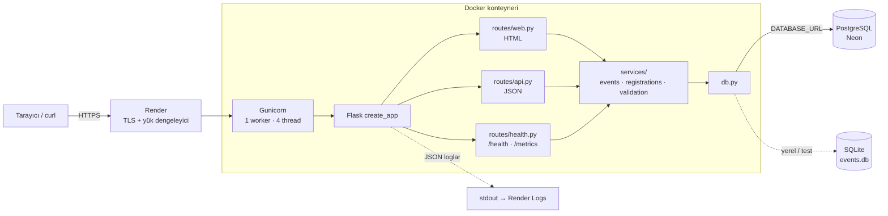
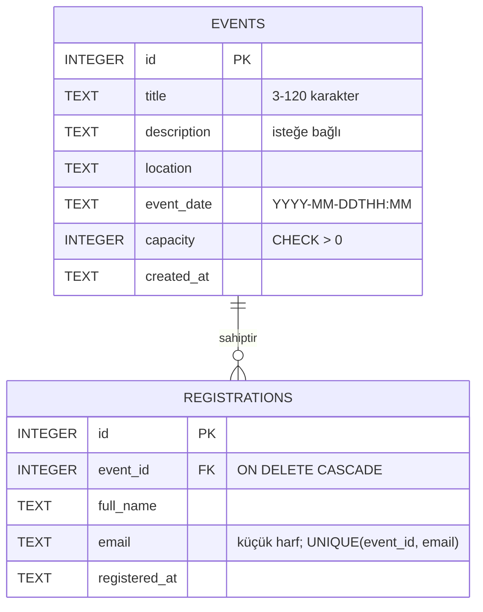
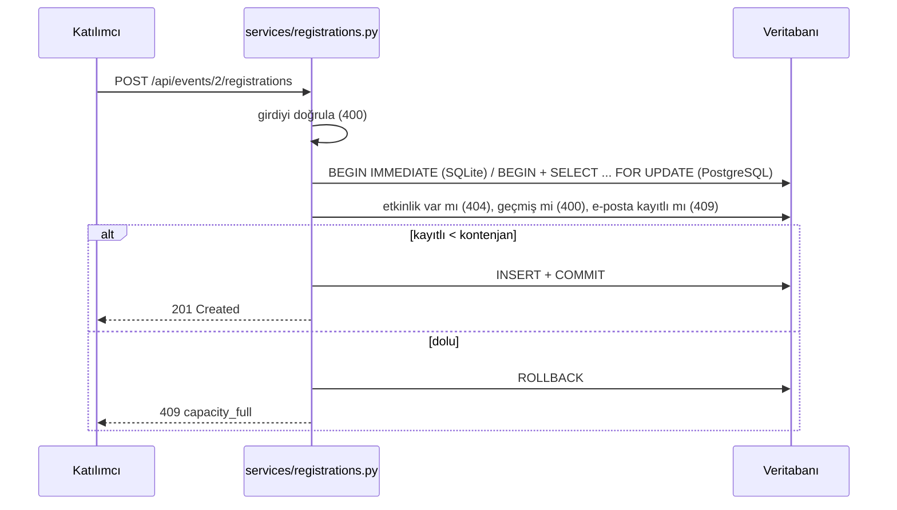
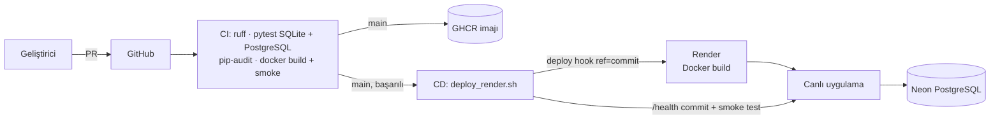

# Mimari ve Veri Modeli

## 1. Genel bakış

Uygulama tek Flask sürecinde çalışan katmanlı bir monolit; kodun tamamı `src/etkinlik/` paketinde. Proje küçük
olduğu için mikroservis yerine bu yapıyı seçtim: dağıtması, test etmesi ve anlatması kolay. İş kuralları HTTP'den
ayrı olduğu için testler de basit.

| Modül (`src/etkinlik/`) | Sorumluluk |
|---|---|
| `__init__.py` | `create_app()`: yapılandırma, loglama, güvenlik, hata yöneticileri, veritabanı, blueprint'ler |
| `config.py` | Ortam değişkenlerinden okunan ayarlar (12-Factor) |
| `routes/web.py` | HTML sayfalar ve formlar; Türkçe tarih ve etkinlik durumu filtreleri (Kayıt açık / Son N yer / Dolu / Sona erdi) |
| `routes/api.py` | `/api/...` JSON uç noktaları |
| `routes/health.py` | `/health` ve `/metrics` |
| `services/events.py` | F1, F2: `validate_event`, `create_event`, `list_events`, `get_event`, `get_stats` |
| `services/registrations.py` | F3, F4, F5: `register_participant`, `cancel_registration`, `list_registrations` |
| `services/validation.py` | Metin, tarih, sayı ve e-posta doğrulama (`clean_email`), e-posta maskeleme |
| `db.py`, `schema.sql`, `schema_postgres.sql` | SQLite / PostgreSQL bağlantısı, şema kurulumu, `transaction()` |
| `errors.py` | `ValidationError` (400), `NotFoundError` (404), `CapacityFullError` ve `DuplicateRegistrationError` (409) |
| `logging_config.py` | JSON log biçimi, `request_id`, istek logu, işlem içi metrik sayaçları |
| `security.py` | CSRF kontrolü (HTML formları), güvenlik başlıkları (CSP vb.) |
| `seed.py` | `SEED_DEMO_DATA=true` ise boş veritabanına 6 örnek etkinlik (1 dolu, 1 neredeyse dolu, 1 geçmiş; tarihler bugüne göre) |

Hata akışı: servisler hata fırlatır; API bunu `{"error": "...", "message": "...", "details": {...}}` JSON'una,
web arayüzü form altı mesajlara ve flash mesajına çevirir.

Başlatma: yerelde `flask run` (`.flaskenv` → `src/etkinlik`), konteynerde
`gunicorn --config deploy/gunicorn.conf.py "etkinlik:create_app()"`.

## 2. Veri modeli

| Ortam | Veritabanı | Ayar |
|---|---|---|
| Yerel, testler, `docker compose` | SQLite dosyası | `DATABASE_PATH` (varsayılan `data/events.db`) |
| Canlı (Render) | PostgreSQL (Neon, ücretsiz) | `DATABASE_URL=postgresql://...?sslmode=require` |

Render'ın ücretsiz planında disk kalıcı olmadığı için canlı veriler Neon'da. Servisler iki motorda aynı SQL'i
çalıştırır: `db.py` `?` parametrelerini psycopg'nin `%s` biçimine çevirir, iki motor da satırları sözlük olarak
döndürür (`row["title"]`). Tarihler ISO 8601 metin olarak saklanır. CI'da testler hem SQLite'ta hem PostgreSQL
servis konteynerinde çalışır.

- Kayıtlı sayısı ayrı sütunda tutulmaz, `COUNT` ile hesaplanır; sayaç ile kayıtlar arasında tutarsızlık olamaz.
- `UNIQUE(event_id, email)` mükerrer kaydı veritabanında da engeller.
- İndeksler: `registrations(event_id)`, `events(event_date)`.

## 3. Kontenjan kontrolü (kritik iş kuralı)

Sayma ve ekleme tek kilit altında yapılır, bu yüzden aynı anda gelen iki istek son boş yeri birlikte alamaz.
SQLite'ta `BEGIN IMMEDIATE` yazma kilidini baştan alır; PostgreSQL'de etkinlik satırı `FOR UPDATE` ile kilitlenir
(farklı etkinliklere yapılan kayıtlar birbirini beklemez). Testlerde 12 eşzamanlı istekle doğrulanıyor.

## 4. REST API

| Metot | Yol | Açıklama | Başarılı | Hatalar |
|---|---|---|---|---|
| GET | `/api/events?q=` | Liste / arama | 200 | - |
| POST | `/api/events` | Etkinlik oluştur | 201 + `Location` | 400 |
| GET | `/api/events/<id>` | Detay + katılımcılar | 200 | 404 |
| POST | `/api/events/<id>/registrations` | Kayıt ol | 201 | 400, 404, 409 |
| POST | `/api/events/<id>/registrations/cancel` | Kaydı iptal et | 200 | 400, 404 |
| GET | `/health` | Sağlık kontrolü | 200 | 503 |
| GET | `/metrics` | Metrikler | 200 | - |

## 5. Dağıtım mimarisi

## 6. Tasarım kararları

| Karar | Gerekçe |
|---|---|
| Katmanlı monolit | Küçük proje; iş kuralları HTTP'den bağımsız test edilir |
| Yerelde SQLite, canlıda Neon PostgreSQL | Yerelde kurulum gerektirmez; Render'ın ücretsiz diski kalıcı değil |
| Ayarlar ortam değişkeninde | Aynı imaj yerelde, CI'da ve Render'da çalışır; gizli bilgi koda girmez |
| JSON loglar + `request_id` | Render Logs'ta alan bazlı arama ve istek takibi |
| Gunicorn 1 worker + 4 thread | Ücretsiz plan belleğine (512 MB) uygun; işlem içi metrikler tek yerde |
| CD'yi GitHub Actions tetikler | Testler geçmeden deploy olmaz; geçmiş Environments'ta görünür |
