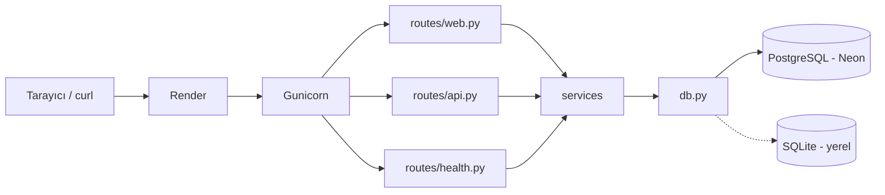

# Mimari ve Veri Modeli

## Genel yapı

Uygulama tek bir Flask uygulaması. Proje küçük olduğu için mikroservis yerine katmanlı bir yapı seçtim:

- `routes/`: HTML sayfaları (`web.py`), JSON API (`api.py`), `/health` ve `/metrics` (`health.py`)
- `services/`: iş kuralları (etkinlik, kayıt, doğrulama)
- `db.py`: veritabanı bağlantısı. Yerelde SQLite, canlıda PostgreSQL kullanılıyor.

İş kuralları route'lardan ayrı olduğu için testlerini yazmak kolay oldu.

Uygulama Docker konteynerinde Gunicorn ile çalışıyor. Ayarlar ortam değişkenlerinden okunuyor, böylece aynı imaj
yerelde, CI'da ve Render'da çalışıyor.

## Veri modeli

İki tablo var: `events` ve `registrations`. Bir etkinliğin birden çok kaydı olabilir.

| Tablo | Alan | Açıklama |
|---|---|---|
| events | `id` | Birincil anahtar |
| events | `title`, `description`, `location` | Etkinlik bilgileri |
| events | `event_date` | Tarih ve saat (`YYYY-MM-DDTHH:MM`) |
| events | `capacity` | Kontenjan, 0'dan büyük |
| events | `created_at` | Oluşturulma zamanı |
| registrations | `id` | Birincil anahtar |
| registrations | `event_id` | `events.id`'ye bağlı |
| registrations | `full_name`, `email` | Katılımcı bilgisi, e-posta küçük harfle saklanır |
| registrations | `registered_at` | Kayıt zamanı |

- `UNIQUE(event_id, email)` aynı e-postanın aynı etkinliğe iki kez kaydolmasını veritabanında da engelliyor.
- Kayıtlı sayısını ayrı bir sütunda tutmadım, her seferinde `COUNT` ile hesaplanıyor.
- Render'ın ücretsiz planında disk kalıcı olmadığı için canlı veriler Neon PostgreSQL'de duruyor.

## Kontenjan aşımı nasıl önleniyor

Son bir yer kalmışken iki kişi aynı anda kayıt olmaya çalışırsa ikisi de "yer var" görüp kaydolabilir. Bunu önlemek
için sayma ve ekleme işlemini tek transaction içinde, kilit alarak yapıyorum:

- SQLite'ta `BEGIN IMMEDIATE` ile yazma kilidi baştan alınıyor.
- PostgreSQL'de etkinlik satırı `SELECT ... FOR UPDATE` ile kilitleniyor.

Kilit alındıktan sonra etkinliğin var olup olmadığı, tarihinin geçip geçmediği, e-postanın daha önce kaydolup
kaydolmadığı ve kontenjan kontrol ediliyor. Yer varsa kayıt ekleniyor, yoksa `409 capacity_full` dönüyor. Bunu
aynı anda 12 istek gönderen bir testle denedim, kontenjan aşılmadı.
